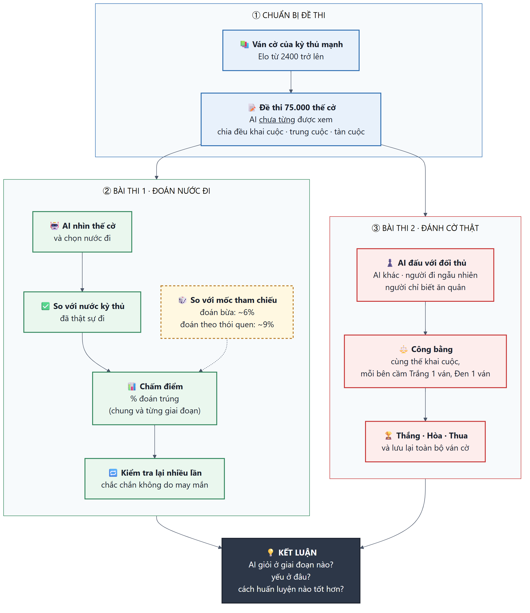
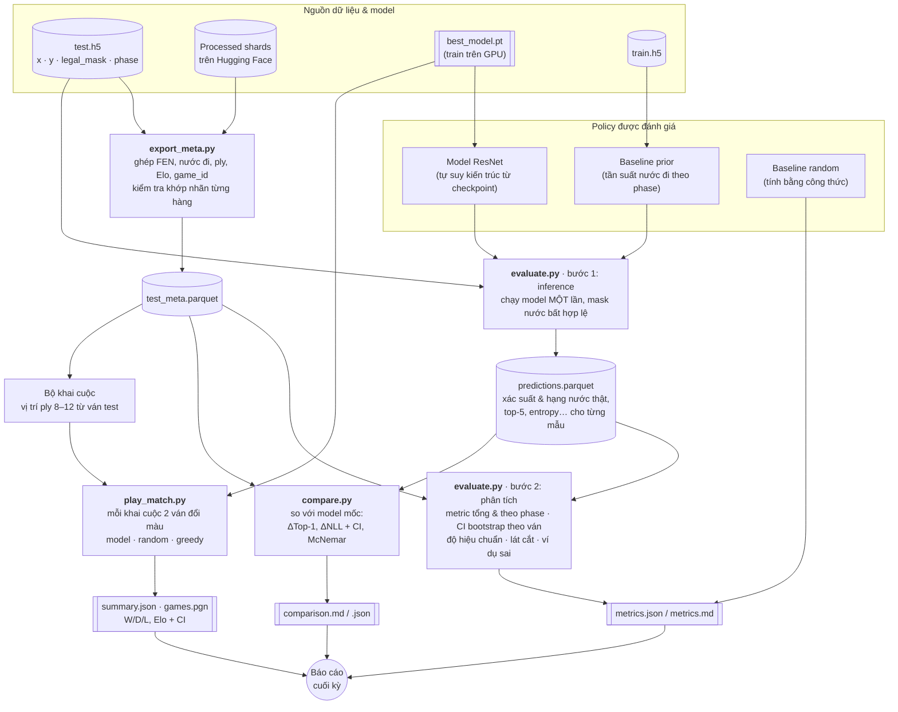

# Tóm tắt phần Evaluation

> Nhóm G14 · IT3160 · Phụ trách: Nguyễn Đức Huân · Cập nhật 14/11/2026
> Code: `src/IT3160/evaluation/` · Script: `scripts/{export_meta, evaluate, compare, play_match}.py`
> Bản dễ hiểu để trình bày cho người không chuyên: [EVAL_OVERVIEW.md](EVAL_OVERVIEW.md)

## 1. Phần evaluation làm gì?

Phần này trả lời câu hỏi chính của proposal: **model có dự đoán đúng nước người chơi mạnh đã đi
trên các ván chưa từng thấy không, và kết quả khác nhau thế nào giữa khai cuộc, trung cuộc, tàn cuộc.**
Việc đánh giá gồm hai cách bổ trợ nhau:

| Cách | Câu hỏi trả lời | Đầu vào | Đầu ra |
| --- | --- | --- | --- |
| **Offline** (trên tập test) | Model dự đoán nước đi tốt đến đâu? | `test.h5` (75.000 thế cờ, 25k mỗi phase) | Metric, khoảng tin cậy, lát cắt, so sánh model |
| **Đấu cờ** (arena) | Model chơi thực tế ra sao? | Hai người chơi + bộ khai cuộc | Thắng/hòa/thua, Elo, PGN |

Cả hai đều chạy được trên CPU máy laptop: evaluate 75k mẫu mất khoảng 6 phút, một trận 50 ván mất dưới 1 phút.

## 2. Sơ đồ hoạt động

### 2.1. Bản dễ hiểu (dùng khi trình bày, kể cả với người không chuyên)

Có thể hiểu như **cho AI làm hai bài thi**: bài 1 là đoán nước đi trên 75.000 thế cờ mà AI chưa từng
thấy, rồi chấm điểm và so với người đoán bừa; bài 2 là cho AI đánh cờ thật với các đối thủ một cách
công bằng. Kết quả hai bài thi cho biết AI giỏi và yếu ở giai đoạn nào của ván cờ.
Mã nguồn sơ đồ: [`images/evaluation_simple.mmd`](images/evaluation_simple.mmd).

### 2.2. Bản kỹ thuật (luồng dữ liệu giữa các script)

## 3. Các thành phần

| Module | Vai trò |
| --- | --- |
| `meta.py` | Ghép metadata từng hàng của file HDF5 (đọc đúng các shard và commit HF mà file đã ghi lại, kiểm tra checksum và nhãn) |
| `checkpoint.py` | Load checkpoint, tự suy số block/kênh nên dùng được cho mọi ablation |
| `inference.py` | Chạy policy trên HDF5 theo khối liên tiếp, ghi kết quả từng mẫu |
| `metrics.py` | NLL, Top-1/3/5, hạng trung bình, MRR, entropy, ECE, tỷ lệ argmax bất hợp lệ khi bỏ mask |
| `baselines.py` | Random hợp lệ (công thức chính xác), prior theo tần suất nước đi ở tập train |
| `significance.py` | CI 95% bootstrap theo ván, chênh lệch có cặp, kiểm định McNemar |
| `slices.py` | Kết quả theo số nước hợp lệ, loại nước, quân đi, nước chiếu, ply, Elo; ví dụ sai nhất |
| `agent.py` / `arena.py` | Chọn nước từ model; tổ chức trận đấu, thống kê và xuất PGN |
| `runner.py` / `report.py` | Gộp các bước và xuất bảng Markdown |

## 4. Key points

1. **Chạy model một lần, phân tích nhiều lần.** Kết quả từng mẫu được lưu lại, nên mọi phân tích và so sánh sau đó không cần chạy lại model.
2. **Luôn có mốc so sánh.** Mọi con số của model được đặt cạnh baseline random và prior, tính riêng cho từng phase, vì độ khó mỗi phase khác nhau (tàn cuộc có ít nước hợp lệ hơn nên dễ đoán hơn).
3. **Có ý nghĩa thống kê.** Mỗi chỉ số đi kèm khoảng tin cậy 95%, lấy mẫu lại **theo ván** vì các thế cờ cùng ván có tương quan. So sánh hai model dùng kiểm định có cặp trên cùng mẫu (McNemar cho Top-1).
4. **Tính đúng NLL theo phase.** Loss được tính trên từng mẫu rồi mới gộp theo phase. Code train cũ dùng loss trung bình của cả batch nên cho số sai.
5. **Đánh giá cả khi chơi thật.** Arena dùng khai cuộc lấy từ ván test (không model nào đã thấy), mỗi khai cuộc đánh hai ván đổi màu, áp dụng luật hòa chuẩn, và tính CI theo cặp khai cuộc.
6. **Tái lập được và có kiểm tra.** Seed cố định, metadata được đối chiếu nhãn từng hàng, mỗi file kết quả ghi lại nguồn dữ liệu và checkpoint. Có 23 test tự động cho phần evaluation.

## 5. Kết quả hiện có

**Baseline trên test** (mốc mà E1/E2 phải vượt):

| Policy | NLL | Top-1 % | Top-3 % | Top-5 % |
| --- | ---: | ---: | ---: | ---: |
| Random hợp lệ | **3,225** | 6,21 | 16,25 | 24,23 |
| Prior theo tần suất | 3,561 | **9,47** | **21,26** | **31,05** |

Prior có NLL tệ hơn random dù Top-1 cao hơn: prior không nhìn vào thế cờ nên gần như cho xác suất 0
với các nước hợp lệ nhưng hiếm gặp, và bị phạt nặng ở NLL.

**Chạy thử với model smoke** (train 1 epoch trên 50k mẫu, chỉ để kiểm tra luồng chạy):

| Kiểm tra | Kết quả |
| --- | --- |
| Offline trên test | NLL 2,593 · Top-1 27,2% · Top-3 49,6% · Top-5 61,2% (vượt rõ cả hai baseline) |
| Smoke vs random (50 ván) | +25 =24 −1 · Elo +182 [+121, +254] · **23 ván stalemate** |
| Smoke vs greedy (50 ván) | +11 =32 −7 · Elo +28 [−33, +91] |

**Quan sát:** model hay tự đưa ván cờ vào thế đối phương hết nước khi đang thắng áp đảo. Đây là hạn chế
của cách "một lần suy luận, không tìm kiếm": model bắt chước nước đi mạnh nhưng không kiểm tra hệ quả
của nước đi. Cần theo dõi chỉ số này với E1 và E2.

## 6. Bước tiếp theo

- Khi có `best_model.pt` của E1, E2: chạy `evaluate.py` trên validation, sau đó trên test, rồi `compare.py` (E1 làm mốc).
- Cho E1 đấu E2 (50 khai cuộc × 2 màu), và cho mỗi model đấu random/greedy.
- Vẽ biểu đồ (learning curve, kết quả theo phase, độ hiệu chuẩn, lát cắt) cho báo cáo W15.
