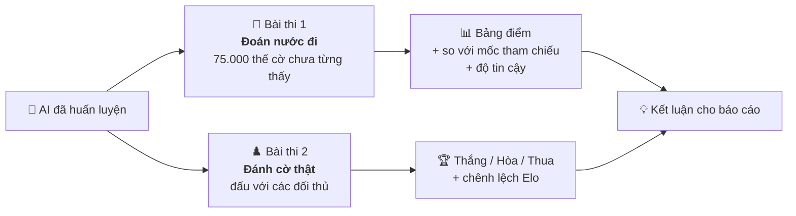
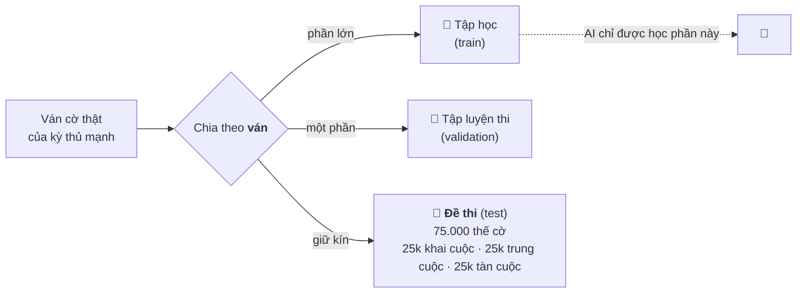
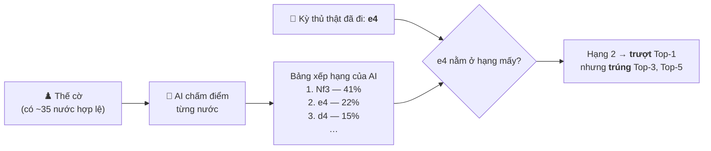
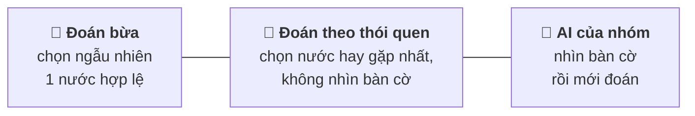
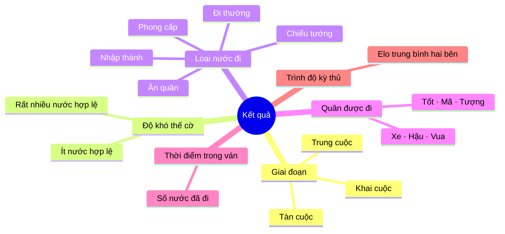
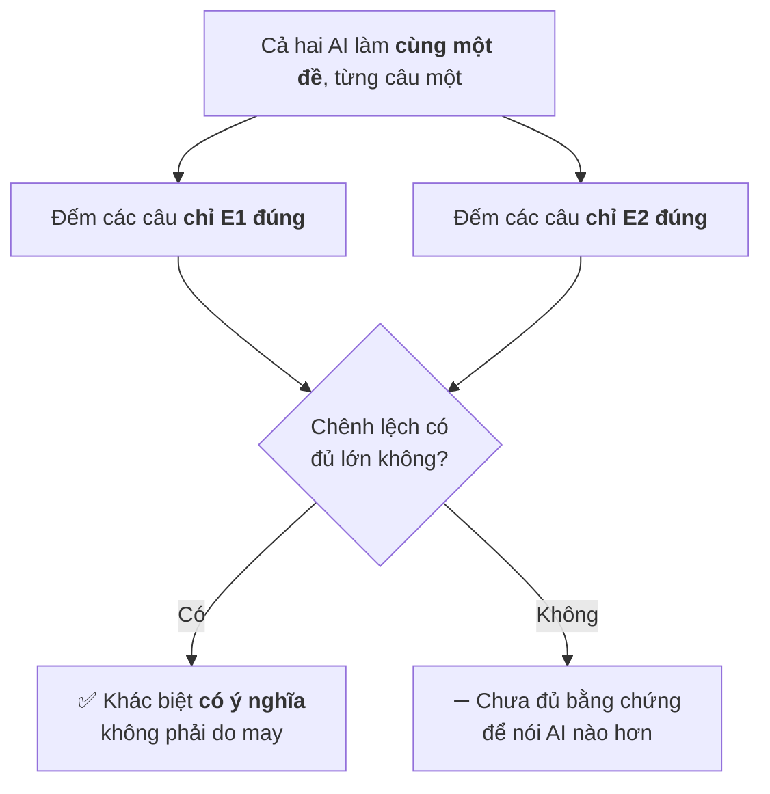
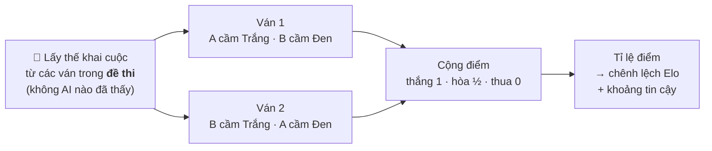
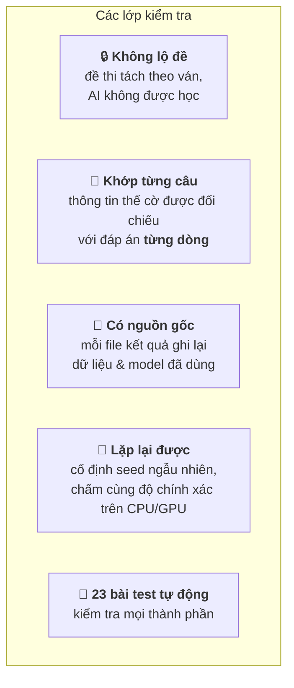
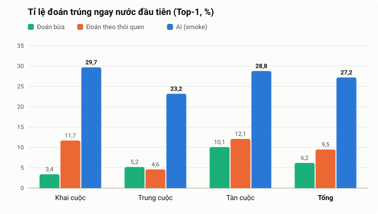
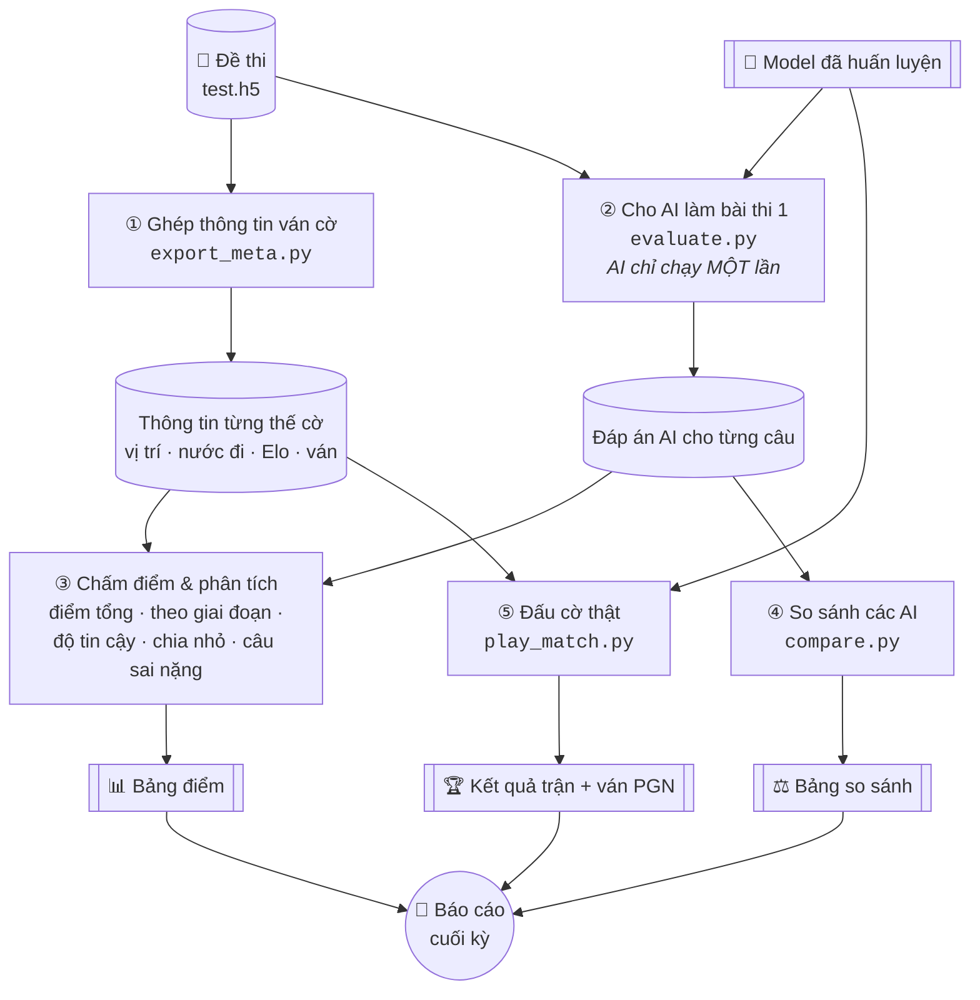

# Phần Đánh giá (Evaluation): bản dễ hiểu

> Nhóm G14 · IT3160 · Phụ trách: Nguyễn Đức Huân · Cập nhật 14/11/2026
> Tài liệu này dùng khi trình bày cho người **không chuyên về cờ vua hay học máy**.
> Bản kỹ thuật đầy đủ (nguồn chính của số liệu và bước tiếp theo): [EVALUATION_SUMMARY.md](EVALUATION_SUMMARY.md) · Cách chạy: [README](../README.md#đánh-giá)

---

## 1. Bài toán trong một câu

Nhóm dạy một AI **nhìn vào bàn cờ và đoán nước mà một kỳ thủ mạnh sẽ đi**.
AI học từ hàng trăm nghìn ván của các kỳ thủ có Elo từ 2400 trở lên.

Phần **Đánh giá** trả lời câu hỏi: *"AI học được đến đâu, giỏi ở đâu, yếu ở đâu, và cách huấn luyện nào tốt hơn?"*

Cách làm giống **cho học sinh làm hai bài thi**:

---

## 2. Bài thi 1: Đoán nước đi

### 2.1. Đề thi lấy từ đâu?

- Đề thi gồm các thế cờ từ những ván mà AI **chưa bao giờ được xem**, giống đề thi không bị lộ.
- Mỗi giai đoạn của ván cờ có **số câu bằng nhau**:
  - **Khai cuộc**: đầu ván.
  - **Trung cuộc**: giữa ván, nhiều quân, phức tạp nhất.
  - **Tàn cuộc**: cuối ván, ít quân.

  Nhờ vậy có thể so sánh công bằng AI làm tốt ở giai đoạn nào.

### 2.2. Chấm một câu như thế nào?

Ở mỗi thế cờ, AI không chỉ đưa ra một đáp án. AI **xếp hạng tất cả các nước đi hợp lệ** kèm mức độ tự tin. Ta xem nước mà kỳ thủ thật đã đi nằm ở hạng mấy.

AI chỉ được chọn trong các **nước hợp lệ**, giống như chỉ được khoanh trong các đáp án có trên đề.

### 2.3. Các con số trên bảng điểm, nói bằng lời thường

| Chỉ số | Ý nghĩa dễ hiểu | Tốt khi |
| --- | --- | --- |
| **Top-1** | % câu AI đoán **trúng ngay lựa chọn đầu tiên** | cao |
| **Top-3 / Top-5** | % câu nước thật nằm trong **3 / 5 lựa chọn đầu** của AI | cao |
| **NLL** ("độ bất ngờ") | AI **ngạc nhiên** đến đâu khi thấy nước thật. Đoán trúng mà tự tin thì điểm thấp; gán gần 0% cho nước thật thì bị phạt rất nặng | thấp |
| **Hạng trung bình** | Trung bình nước thật đứng thứ mấy trong danh sách của AI | thấp |
| **Độ hiệu chuẩn** (ECE) | AI nói "chắc 70%" thì có đúng khoảng 70% số lần không? Đo xem AI có **tự tin hợp lý** không | thấp |
| **Khoảng tin cậy 95%** | Ví dụ "27,2% [26,9 – 27,5]": nếu thi lại với đề tương tự, điểm gần như chắc chắn nằm trong khoảng này | hẹp |

### 2.4. Luôn so với "mốc tham chiếu"

Một con số đứng một mình không nói lên gì. "Đoán trúng 27%" là tốt hay tệ? Vì vậy mọi kết quả đều được đặt cạnh hai người chơi giả định:

> **Điểm đáng chú ý:** tàn cuộc có ít nước hợp lệ nên **đoán bừa cũng trúng nhiều hơn** (~10%) so với khai cuộc (~3%).
> Vì thế các con số được so **trong cùng một giai đoạn**, và mỗi bảng chia nhỏ đều có thêm cột "đoán bừa" làm mốc.

### 2.5. Chia nhỏ kết quả để tìm điểm mạnh, điểm yếu

Ngoài điểm tổng, bảng điểm còn được chia theo nhiều tiêu chí:

Hệ thống còn tự liệt kê **những câu AI sai nặng nhất** ở mỗi giai đoạn, để nhóm xem tận mắt AI hay nhầm kiểu gì.

---

## 3. So sánh hai AI: hơn thật hay chỉ may mắn?

Nhóm sẽ huấn luyện nhiều phiên bản AI, ví dụ **E1** học từ dữ liệu cân bằng giữa các giai đoạn, **E2** học từ dữ liệu tự nhiên. Câu hỏi là: *E2 hơn E1 2% là thật, hay chỉ do may?*

- Vì hai AI làm **đúng cùng một đề**, ta so **từng câu một** (so sánh theo cặp). Cách này nhạy hơn nhiều so với chỉ nhìn hai điểm tổng.
- **Kiểm tra lại nhiều lần (bootstrap):** máy tính rút ngẫu nhiên hàng nghìn "đề thi thử" từ chính đề thật, rồi xem kết luận có giữ nguyên không.
- Các đề thử được rút **theo cả ván cờ**, vì các thế cờ trong cùng một ván giống nhau. Nếu đếm từng thế riêng lẻ thì sẽ tự tin quá mức.
- Hệ thống **từ chối so sánh** nếu hai AI không làm cùng một đề.

---

## 4. Bài thi 2: Đánh cờ thật

Đoán trúng nước đi chưa chắc đã đánh hay. Vì vậy AI còn được cho **đấu thật** với các đối thủ:

| Đối thủ | Là ai |
| --- | --- |
| 🎲 **Random** | Đi ngẫu nhiên một nước hợp lệ |
| 🍖 **Greedy** | Chỉ biết ăn quân có giá trị nhất có thể |
| 🤖 **AI khác** | Ví dụ E1 đấu E2 |

### 4.1. Cách tổ chức trận đấu cho công bằng

- **Cùng thế khai cuộc, đổi màu quân:** Trắng đi trước nên có lợi thế. Mỗi bên cầm Trắng một lần thì lợi thế này triệt tiêu.
- **Khai cuộc lấy từ đề thi:** không AI nào được lợi vì đã thuộc bài.
- **Elo** là thang đo trình độ quen thuộc trong cờ vua. Chênh **+100 Elo** nghĩa là bên mạnh hơn ghi được khoảng **64%** số điểm.
- Mọi ván đều được lưu lại dưới dạng **PGN** (định dạng chuẩn của ván cờ), mở được bằng bất kỳ phần mềm cờ nào để xem lại.
- **Luật kết thúc ván:**
  - Ván dừng ngay khi có thể xin hòa (lặp thế 3 lần hoặc 50 nước không ăn quân, không đi tốt).
  - Ván quá 300 nửa nước được xử hòa.
  - Mặc định người chơi tránh các nước dẫn tới lặp thế.

---

## 5. Làm sao tin được kết quả?

Một chi tiết nhỏ nhưng quan trọng: khi AI cho **hai nước đi điểm bằng nhau**, hệ thống tính theo hướng **bất lợi cho AI**. Như vậy điểm số không bao giờ bị thổi phồng.

---

## 6. Kết quả hiện có

> Số liệu dưới đây chép từ [EVALUATION_SUMMARY.md §5](EVALUATION_SUMMARY.md#5-kết-quả-hiện-có). Khi có kết quả mới, cập nhật ở đó trước rồi chép sang đây.

Model hiện tại là bản **"smoke"**: chỉ huấn luyện 1 vòng trên 50.000 mẫu, dùng để **kiểm tra toàn bộ quy trình chạy được**, chưa phải model cuối.

### 6.1. Bài thi 1: tỉ lệ đoán trúng ngay (Top-1, %)

Mỗi nhóm cột là một giai đoạn. Trong mỗi nhóm, từ trái sang phải: 🎲 **Đoán bừa** (xanh lá) · 📖 **Đoán theo thói quen** (cam) · 🤖 **AI** (xanh dương).

| Người đoán | Khai cuộc | Trung cuộc | Tàn cuộc | **Tổng** |
| --- | ---: | ---: | ---: | ---: |
| 🎲 Đoán bừa | 3,4% | 5,2% | 10,1% | **6,2%** |
| 📖 Đoán theo thói quen | 11,7% | 4,6% | 12,1% | **9,5%** |
| 🤖 AI (smoke) | **29,7%** | **23,2%** | **28,8%** | **27,2%** [26,9 – 27,5] |

**Đọc kết quả:**
- Dù mới huấn luyện rất ít, AI đã đoán trúng **gấp ~4 lần đoán bừa**, và nước thật nằm trong 5 lựa chọn đầu của AI ở **61%** số câu.
- **Trung cuộc khó nhất** với mọi người đoán. Ở trung cuộc, "đoán theo thói quen" còn **thua cả đoán bừa**, vì mỗi thế cờ trung cuộc gần như là duy nhất, không có "nước quen".
- AI **tự tin hợp lý**: độ lệch hiệu chuẩn chỉ khoảng 3%.

### 6.2. Bài thi 2: đánh cờ thật (50 ván mỗi trận)

| Trận | Thắng | Hòa | Thua | Chênh lệch Elo |
| --- | ---: | ---: | ---: | --- |
| AI smoke vs 🎲 Random | 25 | 24 | 1 | **+182** [+121, +254] |
| AI smoke vs 🍖 Greedy | 11 | 32 | 7 | +28 [−33, +91] (chưa đủ chắc chắn) |

**Phát hiện thú vị:**
- Trong trận với Random, có **23 ván hòa do "hết nước đi"** (stalemate): AI đang thắng áp đảo nhưng lại dồn đối thủ vào thế không còn nước hợp lệ nào, và theo luật cờ thì đó là hòa.
- Lý do: AI **bắt chước nước đi của kỳ thủ** nhưng **không tính trước** hệ quả. Đây là hạn chế đã biết của cách tiếp cận "nhìn một lần rồi đi".
- Nhóm sẽ theo dõi chỉ số này ở các model chính thức.

---

## 7. Toàn cảnh quy trình

**Ý tưởng chính của thiết kế:** AI chỉ cần làm bài **một lần** và đáp án được lưu lại. Mọi phân tích, chia nhỏ, so sánh sau đó đều đọc từ đáp án đã lưu, nên nhanh và không tốn thêm tài nguyên máy.

---

## 8. Bước tiếp theo

1. Khi có model chính thức **E1** và **E2**, chạy bài thi 1 trên tập luyện thi (validation) trước, chốt cấu hình, rồi mới chạy trên đề thi (test).
2. So sánh E1 với E2 theo từng giai đoạn: *dữ liệu cân bằng có giúp AI giỏi tàn cuộc hơn không?*
3. Cho E1 đấu E2 (50 thế khai cuộc × 2 màu), và cho mỗi model đấu với Random và Greedy.
4. Vẽ biểu đồ cho báo cáo cuối kỳ.

---

## Phụ lục: Bảng thuật ngữ

| Thuật ngữ | Giải thích ngắn |
| --- | --- |
| **Policy / Model** | AI nhận vào một thế cờ, trả ra mức độ ưu tiên cho từng nước đi |
| **Train / Validation / Test** | Tập học / tập luyện thi (để chọn cấu hình) / đề thi cuối (chỉ dùng khi đã chốt) |
| **Nước hợp lệ** | Nước đi đúng luật cờ tại thế đó |
| **Khai / Trung / Tàn cuộc** | Ba giai đoạn của ván cờ: đầu, giữa, cuối |
| **Top-k** | Nước thật nằm trong k lựa chọn đầu của AI |
| **NLL** | "Độ bất ngờ" của AI khi thấy nước thật; càng thấp càng tốt |
| **Baseline** | Người chơi giả định đơn giản dùng làm mốc so sánh |
| **Khoảng tin cậy 95%** | Khoảng mà kết quả thật gần như chắc chắn nằm trong |
| **Bootstrap** | Rút ngẫu nhiên nhiều "đề thi thử" từ đề thật để đo độ dao động của kết quả |
| **McNemar** | Phép kiểm định so sánh hai AI trên cùng các câu: đếm câu chỉ một bên đúng |
| **Hiệu chuẩn (ECE)** | Độ khớp giữa mức tự tin AI nói ra và tỉ lệ đúng thực tế |
| **Elo** | Thang đo trình độ cờ; chênh 100 Elo ≈ bên mạnh ghi 64% điểm |
| **Stalemate** | Bên đến lượt không bị chiếu nhưng không còn nước hợp lệ: ván hòa |
| **PGN** | Định dạng tệp chuẩn để lưu và xem lại ván cờ |
